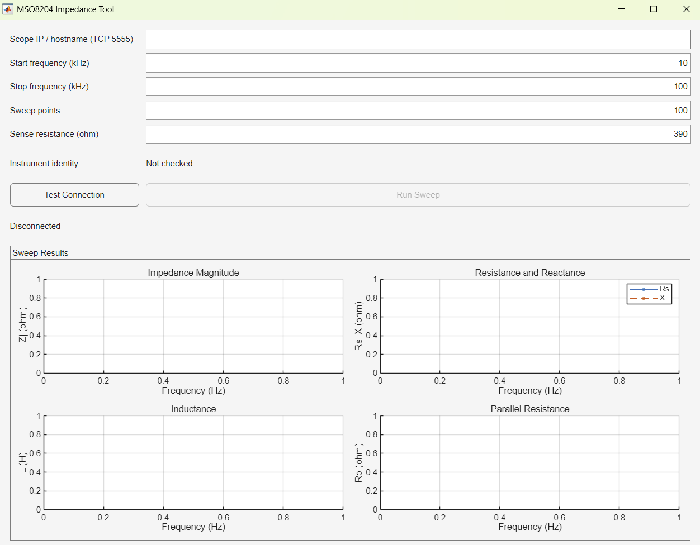

# MSO8204A 임피던스 측정 도구

RIGOL MSO8204A 오실로스코프로 주파수별 임피던스를 측정하는 MATLAB GUI입니다. LAN으로 장비를 식별하고, 두 채널의 전압 파형에서 기본파 페이저를 구합니다. 스윕 중에는 임피던스 크기 `|Z|`, 직렬저항 `Rs`와 리액턴스 `X`, 인덕턴스 `L`, 병렬저항 `Rp`를 그래프로 표시합니다.

## GUI 실행하기

데스크톱 MATLAB이 필요하며, Windows의 MATLAB R2025b에서 실행을 확인했습니다.

1. GitHub에서 **Code > Download ZIP**을 눌러 압축을 풀거나, 저장소를 클론합니다.
2. MATLAB의 현재 폴더를 `mso8204_launcher.m`이 있는 폴더로 지정합니다.
3. MATLAB 명령 창(**Command Window**)에 아래 명령을 입력합니다.

```matlab
mso8204_launcher
```

## 장비 연결 및 측정

1. 오실로스코프를 LAN에 연결하고, **신호발생기 출력 → 측정 대상 → 테스트 저항 → 공통 접지** 순서로 회로를 구성합니다. CH1은 신호발생기 쪽 노드의 전압을, CH2는 테스트 저항 양단의 전압을 측정합니다. 신호발생기 출력을 켜기 전에 배선과 프로브 설정을 확인합니다.
2. 장비의 IP 주소나 호스트 이름을 입력하고 **Test Connection**을 누릅니다. 앱은 TCP 포트 `5555`에서 `*IDN?`으로 장비를 식별하며, MSO8204A가 확인되면 **Run Sweep**이 활성화됩니다.
3. 시작·종료 주파수(kHz), 측정 포인트 수, 실제 테스트 저항값(Ω)을 입력합니다. 기본값은 10~100 kHz, 100포인트, 390 Ω입니다.
4. **Run Sweep**을 누른 뒤 신호발생기 설정을 확인하고 결과를 저장할 폴더를 선택합니다. 앱은 오실로스코프의 내장 신호발생기를 사용해 스윕하고, 같은 창의 그래프 네 개를 Plot합니다. 결과는 측정 시각이 포함된 이름으로 Excel과 MATLAB MAT 파일에 저장됩니다.



## 계산 및 검증 범위

두 채널 전압의 복소 기본파 페이저로 `I = Vshunt / Rshunt`와 `Z = (Vtotal - Vshunt) / I`를 계산합니다.

실제 측정에는 RIGOL MSO8204A 오실로스코프가 필요합니다. 이 코드는 내장 Function Generator의 G1 출력만 사용하므로, 별도의 2-Channel Function Generator는 필요하지 않습니다.
